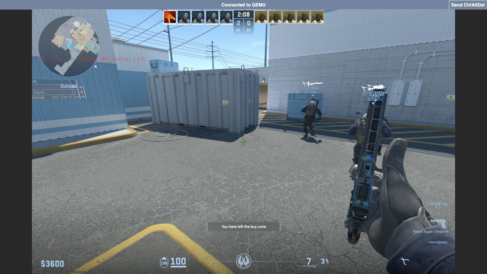

# macOpenVM

An experimental, source-available macOS virtual machine app and CLI for Apple silicon.
Windows 11 ARM64 is the main development goal; ARM64 Linux uses Apple's native
Virtualization framework. This is a **source-only alpha**, with incomplete features.

**Build requirement: macOS SDK 27 and Swift 6.4 (Xcode 27 or Command Line Tools 27).**
The macOS 14 deployment target is separate from the build SDK requirement.
Local development used Command Line Tools 27, macOS SDK 27 and Swift 6.4. CI
targets an ARM64 Xcode 27 runner; see the [current checks](https://github.com/alexanderisgood/macOpenVM/actions/workflows/ci.yml).



*Private Windows development VM using VNC. Its required runtime and driver
binaries are not included. This screenshot is not an FPS benchmark or HDR proof.*

## License and distribution

You can download, modify, and build macOpenVM under the
[macOpenVM Source License](LICENSE). You can also share source and patches
under those terms. Distributing compiled macOpenVM builds requires written
permission from the copyright holders. The official prebuilt macOS app is
planned as a one-time purchase.

[NOTICE](NOTICE) lists separately licensed code and components. Revisions
published under [Apache 2.0](https://github.com/alexanderisgood/macOpenVM/blob/baea3b7899e9abf013525ee72e97354d184a94d5/LICENSE)
remain available under those terms.

## What is here

The repository contains the original Swift app and CLI, lifecycle and storage
code, a VM library, input and display handling, generated protocols, and tests.
Linux boot and desktop experiments have run locally. Windows has run in a private
development environment, but its pinned runtime is not reproducible from this
public source snapshot.

The source tree contains no operating-system media, VM data, firmware, driver
binaries, build products or private Windows runtime. Windows HDR is unavailable.
The included HDR host code is an inactive foundation. Sustained 120 FPS,
near-native performance and FPS-neutral sharpening are not qualified.

## Windows 11 ARM64 guest drivers

macOpenVM includes a native **Guest Tools installer** and a reproducible recipe
for preparing optional driver discs. Development app bundles with these discs
offer **Machine → Install Guest Tools**. Inside Windows, one **Install / Repair**
action installs matching network, guest-communication and graphics drivers,
checks their status, and offers the recommended storage setup. The
[Guest Tools build script](scripts/build-guest-tools.py) prepares the installer.

**Stuck at “Let’s connect you to a network”?** Enable Shared networking, attach the
driver disc, then select `drivers/netkvm` from Windows’ **Install driver** button.
The same instructions are available in **Help → Windows Setup & Drivers**.

The separate [VirtIO driver preview](https://github.com/alexanderisgood/macOpenVM/releases/tag/windows-arm64-virtio-0.1.302-1)
provides the upstream NetKVM network, VirtIO serial and VirtIO GPU 2D display
packages as a ZIP with their licenses and checksums. The guest needs the matching
virtual device for each driver. This download contains guest drivers only. The
Windows installer and the experimental Windows host runtime are separate prerequisites.

Accelerated graphics requires a compatible host runtime and a separate Neptune
driver. The [upstream Neptune v0.4 release](https://github.com/osy/kvm-guest-drivers-windows/releases/tag/v0.4)
provides the ARM64X package for the matching wire protocol 2 host.
The accelerated Guest Tools profile packages this signed driver when building
with the required inputs; it is different from the VirtIO GPU 2D package.
Graphics remains experimental, with rendering and live-resize issues still open.
The public source build does not include the complete Windows host runtime or
Windows itself; it is not yet a turnkey Windows VM download.

## Storage and setup defaults

New Windows VMs use host-sized CPU and memory recommendations and a **128 GiB
sparse disk limit**. The limit is not preallocated space; existing VMs keep their
saved sizes. **Customize hardware** exposes the manual controls.

Guest Tools' **Save disk space** option turns off Windows hibernation and Fast
Startup and asks Windows to reclaim unused disk blocks. It preserves paging,
recovery, updates and personal files, and adds no compression. Users can opt out,
review separate storage results, or open Windows Storage settings from the
installer. Guest free space is not the same as physical space reclaimed on the Mac.

## Build and check

Select the intended Xcode or Command Line Tools installation, confirm its SDK
is version 27, and have Python 3 available. From this source directory:

```sh
xcrun --sdk macosx --show-sdk-version
xcrun swift --version
./scripts/check.sh
./scripts/build.sh debug
./scripts/build.sh release
```

Build output is `build/macOpenVM.app` and `build/bin/macopenvm`. Development builds
use ad hoc signing and are not notarized. Native guest and hardware tests have
separate prerequisites; a skip does not qualify that feature.

The clean public source copy passed 1,319 Swift tests on Apple silicon with
CLT 27/SDK 27/Swift 6.4. Strict formatting, generated protocol/SPDX checks, 33 portable benchmark tests
and signed debug/release bundles also passed. See the [hosted checks](https://github.com/alexanderisgood/macOpenVM/actions/workflows/ci.yml) for current CI results.
Older compiler/toolchain support is unqualified for this alpha.

## Contribute

Useful work includes a reproducible Windows source-build recipe, graphics
performance measurements and fixes, audio, HDR producer integration, and failure
tests. Open an issue describing the behavior and evidence you can reproduce.

The [source license](LICENSE) describes the terms for contributions to macOpenVM.

Project: [github.com/alexanderisgood/macOpenVM](https://github.com/alexanderisgood/macOpenVM).
