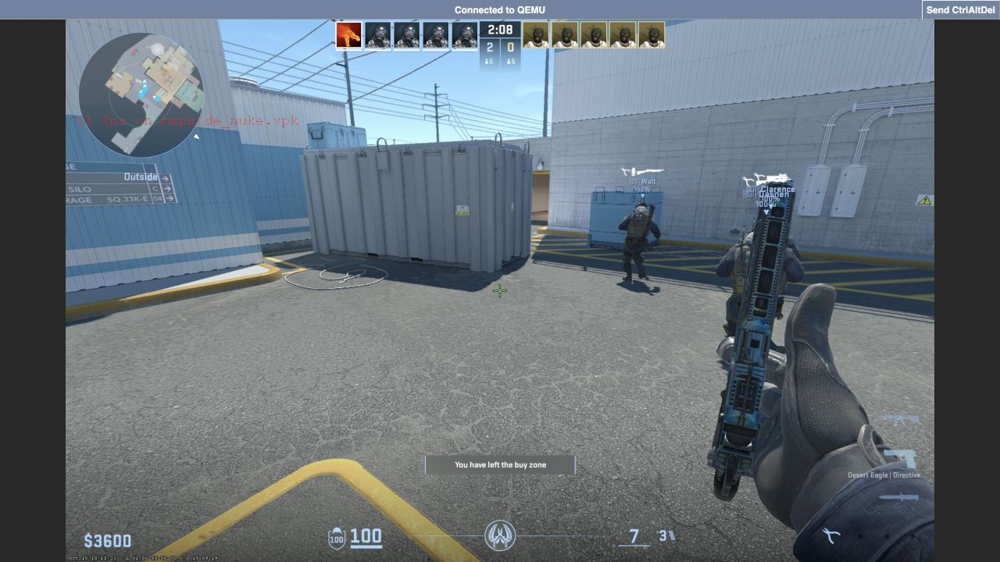

# macOpenVM

An experimental macOS virtual machine app and CLI for Apple silicon.
Windows 11 ARM64 is the main development goal; ARM64 Linux uses Apple's native
Virtualization framework. This is a **source-only alpha**, with incomplete features.

**Build requirement: macOS SDK 26 or later and a compatible Swift 6 toolchain.**
The macOS 14 deployment target is separate from the build SDK requirement.
Local development used Command Line Tools 27, macOS SDK 27 and Swift 6.4. CI
targets an ARM64 macOS 26 runner with Xcode 26.6; public CI validation is pending.



*Private Windows development VM using VNC. Its required runtime and driver
binaries are not included. This screenshot is not an FPS benchmark or HDR proof.*

## What is here

The repository contains the original Swift app and CLI, lifecycle and storage
code, a VM library, input and display handling, generated protocols, and tests.
Linux boot and desktop experiments have run locally. Windows has run in a private
development environment, but its pinned runtime is not reproducible from this
public source snapshot. See the [feature matrix](FEATURE_MATRIX.md).

No operating-system media, VM data, firmware, driver binaries, build products
or private Windows runtime is supplied. Obtain any external software and licenses
separately. Windows HDR is unavailable; the included HDR host code is an inactive
foundation. Sustained 120 FPS, near-native performance and FPS-neutral sharpening
are not qualified.

## Build and check

Select the intended Xcode or Command Line Tools installation, confirm its SDK
is version 26 or later, and have Python 3 available. From this source directory:

```sh
xcrun --sdk macosx --show-sdk-version
xcrun swift --version
./scripts/check.sh
./scripts/build.sh debug
./scripts/build.sh release
```

Build output is `build/macOpenVM.app` and `build/bin/macopenvm`. Development builds
use ad hoc signing and are not notarized. Native guest and hardware tests have
separate prerequisites; a skip does not qualify that feature.

The clean public source copy passed 1,319 Swift tests on Apple silicon with
CLT 27/SDK 27/Swift 6.4. Other clean-copy checks and public CI are pending.
The [release notes](docs/release.md) describe this source preview's limits.

## Contribute

Useful work includes a reproducible Windows source-build recipe, graphics
performance measurements and fixes, audio, HDR producer integration, and failure
tests. Start with [CONTRIBUTING.md](CONTRIBUTING.md) and open an issue describing
the behavior and evidence you can reproduce.

Original app and CLI code is [Apache-2.0](LICENSE). Upstream patches retain their
own file licenses and notices; see [NOTICE](NOTICE). Security reports belong in
the [private reporting process](SECURITY.md). Community participation follows the
[code of conduct](CODE_OF_CONDUCT.md).

Project: [github.com/alexanderisgood/macOpenVM](https://github.com/alexanderisgood/macOpenVM).
